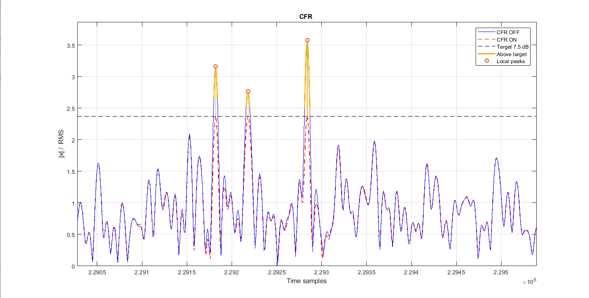
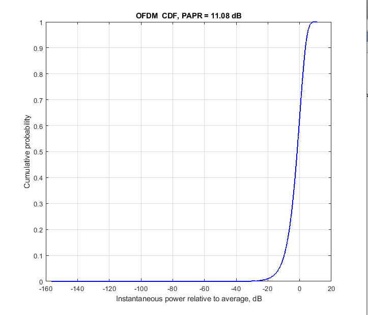
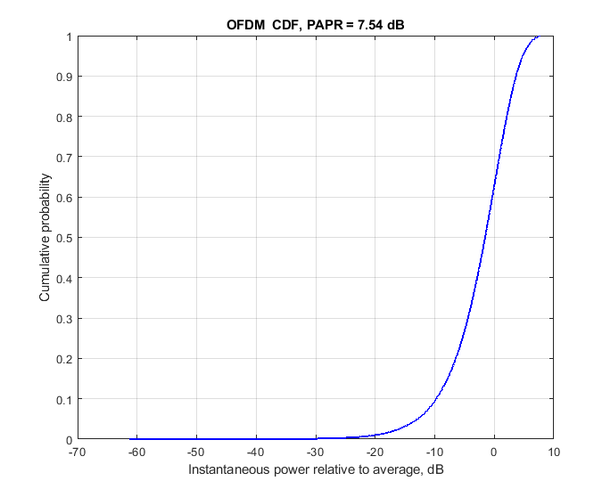

# CFR для OFDM

Алгоритм снижения пик-фактора OFDM-сигнала в MATLAB. CFR (Crest Factor Reduction) уменьшает редкие высокие пики, чтобы сигнал предъявлял меньшие требования к запасу усилителя по амплитуде.

## Как это работает

В OFDM много поднесущих складываются в один сигнал. Иногда их колебания совпадают по фазе и образуют высокий пик. PAPR показывает отношение пиковой мощности к средней.

Здесь используется последовательная компенсация пиков:

1. Алгоритм находит пик выше заданного порога.
2. Вычитает в этой точке корректирующий импульс с учётом амплитуды и фазы сигнала. Спектр импульса ограничен занятой полосой OFDM.
3. Повторяет обработку, пока пики не опустятся до порога или не будет достигнуто ограничение числа коррекций.

Это не простое обрезание отсчётов. Импульс влияет и на соседние отсчёты, поэтому после коррекции пики проверяются снова. В конце восстанавливается средняя мощность сигнала. Снижение пиков вносит искажения, их уровень оценивается через EVM.

## Стенд

- OFDM, 16-QAM, канал 5 МГц и 300 активных поднесущих.
- Частота дискретизации 30,72 МГц, FFT 2048, шаг поднесущих 15 кГц.
- Циклический префикс и WOLA. CFR работает после формирования полного кадра.
- Целевой PAPR 7,5 дБ, до 64 корректирующих импульсов на интервал OFDM-символа с префиксом.

Репозиторий запускается самостоятельно. Модели усилителя, DPD и файлы измерений для него не нужны.

Проверено в MATLAB R2017b: самотест и запуск на полном OFDM-кадре.

## Результаты

На приведённых графиках PAPR уменьшается с **11,08 до 7,54 дБ**, то есть на **3,54 дБ**.

### Подавление пиков

Синим показан исходный сигнал, красным сигнал после CFR. Чёрный пунктир обозначает целевой порог, оранжевым выделены превышения порога исходным сигналом.

### Без CFR

CDF показывает долю отсчётов, у которых мгновенная мощность относительно средней не превышает значение по горизонтальной оси. У исходного сигнала PAPR составляет 11,08 дБ.

### С CFR

После обработки максимальный уровень мощности относительно средней снижается до 7,54 дБ. Основная масса отсчётов на CDF меняется мало, поскольку CFR воздействует прежде всего на редкие высокие пики. Масштабы горизонтальных осей на двух скриншотах различаются.

